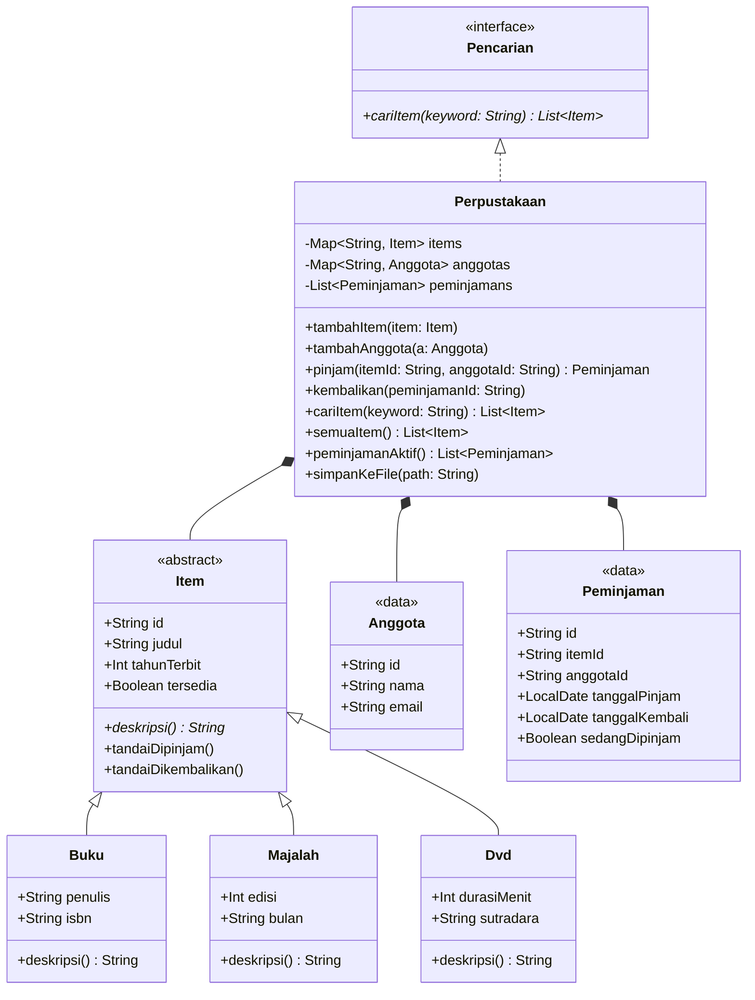

# SIMPUS - Sistem Informasi Manajemen Perpustakaan

## Deskripsi
Aplikasi Sistem Informasi Manajemen Perpustakaan berbasis CLI yang dibangun menggunakan Kotlin dengan menerapkan prinsip Pemrograman Berorientasi Objek (OOP): Abstraction, Encapsulation, Inheritance, dan Polymorphism.

## Fitur
- [x] Menambahkan koleksi item perpustakaan (Buku, Majalah, DVD)
- [x] Menambahkan data anggota perpustakaan
- [x] Peminjaman item oleh anggota
- [x] Pengembalian item yang sedang dipinjam
- [x] Pencarian item berdasarkan kata kunci (judul atau deskripsi)
- [x] Melihat daftar seluruh koleksi item beserta status ketersediaannya
- [x] Melihat daftar peminjaman aktif
- [x] Penyimpanan otomatis data ke file CSV (`data/perpustakaan.csv`)

## Arsitektur
Arsitektur berlapis (*layered architecture*):
- **Model**: `Item` (*abstract class*), `Buku`, `Majalah`, `Dvd`, `Anggota` (*data class*), `Peminjaman` (*data class*)
- **Service**: `Pencarian` (*interface*), `Perpustakaan` (*business logic*)
- **Exception**: `PerpustakaanException` (*sealed class*) dan turunan *custom exception*
- **UI (CLI)**: `Main.kt` (antarmuka konsol)



## Cara Menjalankan

### Lokal
```bash
./gradlew run --console=plain
# atau di Windows PowerShell:
.\gradlew.bat run --console=plain
```

### Docker
```bash
docker compose build
docker compose run --rm simpus
```

### Menjalankan Unit Test
```bash
./gradlew test
# atau di Windows PowerShell:
.\gradlew.bat test
```

## Teknologi
- Kotlin
- Gradle
- JUnit Platform / Kotlin Test
- Docker
